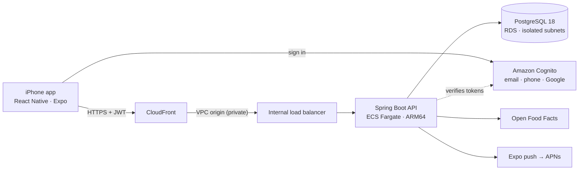

# Progression

[](https://github.com/MMusa39/progression/actions/workflows/ci.yml)
[](LICENSE)


**A full-stack iOS app for people who lift: log workouts fast, see every lift
progress, and track body weight and nutrition, in one place.**

Built end to end: a React Native app, a Java / Spring Boot REST API on
PostgreSQL, and AWS infrastructure defined as code with the CDK, with CI,
about 240 automated tests and 12 architecture decision records.

<!--
  Screenshots: add 4–5 iPhone screenshots to docs/images/ and uncomment.
  Suggested: logger with an overload hint, Progress → Strength, Food diary,
  Nutrition trends, Friends.

<p align="center">
  
  
  
  
  
</p>
-->

## The problem

Most lifters track workouts in their phone's notes app:

```
Bench Press
185 x 8, 8, 7
```

That works for one session but falls apart over months. You can't easily
answer *what did I do last time?*, *am I actually getting stronger?* or *when
did I last hit a PR?* Progression keeps the speed of a note but stores
structured data, so it can answer those questions, and tell you what to lift
next.

## What it does

**Train**
- Log sets in a few taps; last session's numbers appear as suggestions, so repeating them is one tap per set
- **Routines** with target sets and rep ranges; **progressive-overload hints** ("Today: 190 lb × 6") that pre-fill the set
- Rest timer with a background notification, sticky exercise notes ("Seat at 4"), a plate calculator, a weekly goal
- Works offline: workouts save on the phone and sync when the signal returns

**Progress**
- Strength over any time range: estimated one-rep max per lift, automatic personal records, weekly streaks
- Body weight as a smoothed trend that ignores daily water swings, with your weekly rate and projected goal date

**Eat**
- Food diary with barcode scanning (Open Food Facts), recipes, quick add, water
- Calorie and macro targets from your body and goal, with safe-pace limits and **adaptive maintenance** that learns from what you log
- Nutrition trends: "18 of 26 days on target" per macro, not just averages

**Social and privacy**
- Mutual friends, invite links, a consistency leaderboard and per-lift strength rankings; share recipes
- Push notifications; export all your data or delete your account from the app

## Engineering highlights

- **Offline-first, retry-safe sync.** The phone generates every id, and saves are idempotent `PUT`s with last-write-wins conflict detection, so a flaky gym connection can retry without duplicating a workout. ([ADR 0003](docs/adr/0003-client-generated-ids-and-idempotent-upserts.md))
- **Analytics in SQL.** Estimated 1RM, PRs (judged only against *earlier* workouts) and time-zone-aware weekly streaks come from SQL over a `working_set` view, not stored counters, so editing an old workout corrects every chart. ([V3 migration](backend/src/main/resources/db/migration/V3__stats_view_and_e1rm.sql), [StatsRepository](backend/src/main/java/com/progression/stats/StatsRepository.java))
- **Adaptive calorie targets.** Maintenance is estimated from 28 days of logged intake against an exponentially smoothed weight trend, blended with the Mifflin-St Jeor formula as data accumulates and clamped for safety. ([ADR 0010](docs/adr/0010-food-tracking-and-targets.md), [NutritionService](backend/src/main/java/com/progression/nutrition/NutritionService.java), [WeightTrend](backend/src/main/java/com/progression/body/WeightTrend.java))
- **Multi-issuer authentication.** One Spring Security resource server accepts Cognito tokens (email, phone or Google sign-in) in production and locally signed tokens in development, with Cognito-specific validation that rejects ID tokens. ([ADR 0005](docs/adr/0005-cognito-authentication.md), [SecurityConfig](backend/src/main/java/com/progression/common/security/SecurityConfig.java))
- **Privacy enforced in one place.** Friends see only what you share, strangers get `404` rather than `403` (so the API never confirms an account exists), and body weight and food are never shared. ([ADR 0008](docs/adr/0008-friends-and-privacy.md))
- **Event-driven notifications.** Domain events are published after the database transaction commits and sent asynchronously to Expo push, so a slow push service never slows down saving a workout. ([ADR 0009](docs/adr/0009-push-notifications.md))
- **A production AWS design at half the usual cost.** CloudFront reaches an *internal* load balancer through a VPC origin, giving HTTPS without a domain and no public entry point except CloudFront. There's no NAT gateway, everything runs on Graviton, and it costs about $35/month. ([ADR 0012](docs/adr/0012-deployment-architecture.md), [infra/](infra/))
- **Testing at every layer.** Integration tests against real PostgreSQL (Testcontainers), assertions on the synthesized CloudFormation, unit tests for the app's logic, and a Playwright end-to-end test that drives 26 real flows. ([docs/testing.md](docs/testing.md))

## Architecture



More in [docs/architecture.md](docs/architecture.md) and the [decision records](docs/adr/).

## By the numbers

| | |
| --- | --- |
| Codebase | ~8,100 lines of Java, ~12,700 of TypeScript |
| API | 66 REST endpoints, documented in [docs/api.md](docs/api.md) and OpenAPI |
| Database | 10 Flyway migrations |
| App | 38 screens |
| Tests | 145 backend · 84 mobile · 11 infrastructure · 26-step end-to-end |
| Decisions | 12 [architecture decision records](docs/adr/) |

## Tech stack

| Layer | Technology |
| --- | --- |
| Mobile | React Native, Expo SDK 57, TypeScript, Expo Router, TanStack Query, zustand, custom SVG charts |
| Backend | Java 25 (virtual threads), Spring Boot 4, Spring Security (OAuth2 resource server), Spring Data JPA + JdbcClient |
| Database | PostgreSQL 18, Flyway |
| Auth | Amazon Cognito: email, phone or Google (OAuth 2.0 + PKCE) |
| Infrastructure | AWS CDK (Java): ECS Fargate, RDS, internal ALB, CloudFront, Secrets Manager, CloudWatch; Docker |
| Quality | JUnit 5, Testcontainers, CDK assertions, Jest, Playwright, ESLint, GitHub Actions |

## Run it locally (about 5 minutes)

Needs JDK 25, Docker and Node 24 ([setup guide](docs/development-setup.md)).

```bash
git clone https://github.com/MMusa39/progression.git && cd progression
cd backend && ./gradlew bootRun              # terminal 1: API on :8080 (starts PostgreSQL in Docker)

python3 backend/scripts/seed_dev_data.py     # terminal 2, once the API is up: 16 weeks of demo data
cd mobile && npm install && npx expo start   # scan the QR code with Expo Go on an iPhone
```

Tap **Use development account** to sign in with the demo data. `npx expo start --web` runs the app in a desktop browser instead.

## Repository layout

```
progression/
├── backend/   Spring Boot REST API (Java), Dockerfile, dev seed script
├── mobile/    Expo / React Native app (TypeScript), Jest and Playwright tests
├── infra/     AWS CDK app: auth, data and API stacks (Java)
├── docs/      Architecture, data model, API, testing, release, decision records
└── scripts/   start / stop everything for local development
```

## Documentation

- [Architecture](docs/architecture.md) · [Data model](docs/data-model.md) · [API](docs/api.md)
- [Architecture decision records](docs/adr/): why each key choice was made
- [Testing](docs/testing.md) · [Development setup](docs/development-setup.md) · [Roadmap](docs/roadmap.md)
- [Backend](backend/README.md) · [Mobile](mobile/README.md) · [Infrastructure](infra/README.md) READMEs
- [Release checklist](docs/release.md): status and the steps to ship on the App Store

## Status

Feature-complete and built to production standards: containerized, with
infrastructure as code, CI and data export/deletion. Next: deploy to AWS and
submit to the App Store ([docs/release.md](docs/release.md)).

## License

[MIT](LICENSE) © 2026 Mohammad Musa
